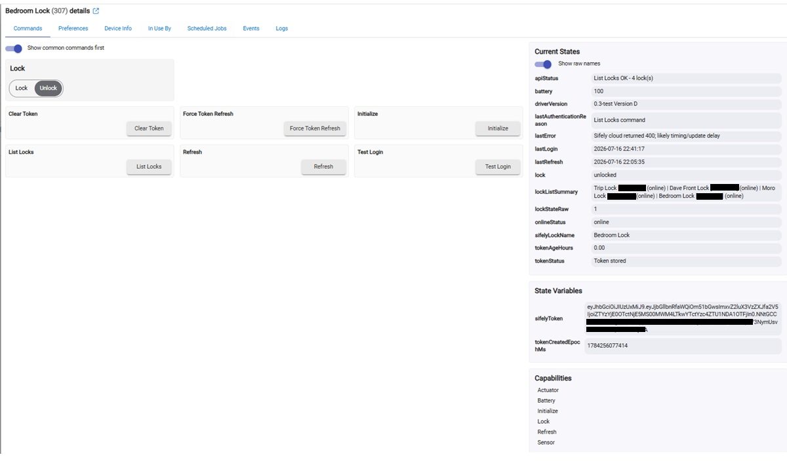
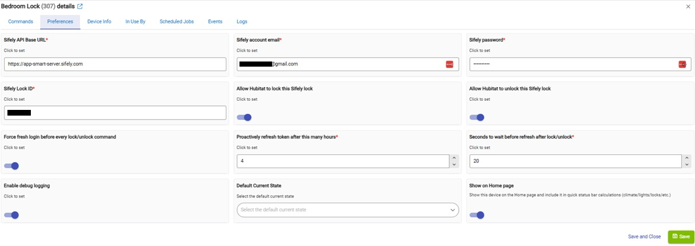

# Unofficial Sifely S WiFi Lock Driver for Hubitat

An unofficial Hubitat cloud driver for Sifely S WiFi smart locks.
This project is not affiliated with or endorsed by Sifely.

## Screenshots

### Driver Commands

### Driver Preferences

## Current Release

**Version 2.0.1 — Recommended (Open API key)**

Use **`Sifely-WiFi-Lock-Driver-v2.groovy`**. It authenticates with a Sifely Open API key from [connect.sifely.com](https://connect.sifely.com) against `https://cus-openapi.sifely.com` (`Authorization: sk-...`, no Bearer).

**Version 1.0.0 — Legacy (email/password)** remains in `Sifely-WiFi-Lock-Driver.groovy` for reference. The legacy `app-smart-server.sifely.com` login path has been failing with "authentication failed" since about 2026-09-29; prefer v2 for new installs and for existing locks that stopped responding.

## Which file should I install?

| File | Driver type in Hubitat | Auth | Status |
|------|------------------------|------|--------|
| `Sifely-WiFi-Lock-Driver-v2.groovy` | **Sifely WiFi Lock v2** | Open API key (`sk-...`) | **Recommended** |
| `Sifely-WiFi-Lock-Driver.groovy` | Sifely WiFi Lock | Account email + password | Legacy |

v2 keeps the same capabilities, attributes, and command names as v1 so existing rules keep working after you switch the device type and enter the API key.

## Installation (v2 — recommended)

1. In Hubitat, open **Drivers Code**.
2. Choose **New Driver** (or open an existing Sifely driver to replace it).
3. Copy the contents of `Sifely-WiFi-Lock-Driver-v2.groovy`.
4. Paste into Hubitat and select **Save**.
5. Assign the driver type **Sifely WiFi Lock v2** to each Sifely device.
6. Enter your **Sifely Open API key** from connect.sifely.com and the Lock ID.
7. Enable remote locking and remote unlocking as appropriate.
8. Select **Save Preferences**, then run **Initialize**, **testLogin** (validates the key), and **Refresh**.

Legacy username/password preference fields may still appear on v2; they are unused.

## Installation (v1 — legacy)

1. Copy `Sifely-WiFi-Lock-Driver.groovy` into Drivers Code.
2. Assign driver type **Sifely WiFi Lock**.
3. Enter Sifely account email, password, and Lock ID.
4. Save Preferences, then Initialize / Refresh.

## Finding Lock IDs

Run **List Locks** from the Hubitat device page. The driver logs each lock and records a summary in the `lockListSummary` attribute.

## Features

- Hubitat Lock capability (lock / unlock)
- Battery reporting
- Online/offline status and Sifely lock name
- List Locks
- Delayed post-command refresh
- Diagnostic commands (`testLogin`, token helpers on v1; API-key validation on v2)

## Important Notes

- This is an unofficial community integration and is not affiliated with or supported by Sifely or Hubitat.
- Lock control and status depend on the Sifely cloud service and an active internet connection.
- Do not post credentials, API keys, or identifying lock information in public logs or screenshots.

## Known issue fixed: locks showing "offline (gateway)"

**In testing:** v2.0.2-testing (API key) and v1.0.1-testing (username/password). Stable releases are unchanged: v2.0.1 (API key) and v1.0.0 (username/password).

#### Problem
Hubitat showed Sifely locks as **"offline (gateway)"** even when the Sifely mobile app showed the gateways and locks as **Online**, and even while Hubitat's lock state and battery refreshes were working.

#### Cause
The driver copied Sifely's `isOnline` flag as-is and labeled `hasGateway=1` + `isOnline=0` as "offline (gateway)". For gateway-paired locks, Sifely can report that flag as `0` while the lock is still reachable through the gateway.

Separately, `lockListSummary` was only updated by `listLocks` / `testLogin`, not by `refresh()`. It went stale, so locks looked online on one device and offline on another.

#### Fix
- When a gateway-paired lock's state query succeeds, `onlineStatus` now reports **"via gateway"** instead of "offline".
- `lockListSummary` is refreshed on every `refresh()`, and gateway-paired locks show as "via gateway" there too.
- New `reachable` attribute (`true` / `false`), based on whether the lock state query succeeded.

No changes to commands or capabilities, so existing rules keep working. If any rule checks for `onlineStatus == "online"`, also allow `"via gateway"`, or use the new `reachable` attribute.

## Roadmap

### ✅ v1.0.0
- Lock / Unlock, Refresh, multi-lock support
- Hubitat automation support
- Email/password login with automatic token refresh

### ✅ v2.0.1 (current)
- Sifely Open API key auth (`cus-openapi.sifely.com`)
- Same capabilities/commands as v1 for rule compatibility

### 🧪 v2.0.2-testing / v1.0.1-testing (in testing)
- Gateway-paired locks report `via gateway` instead of `offline (gateway)`
- `lockListSummary` refreshed on every refresh; new `reachable` attribute

### 🚧 v3.0.0 (planned)
- **Single consolidated driver** with a preference to choose auth mode:
  - **Login** (email/password, legacy server) **or**
  - **API key** (Open API / connect.sifely.com)
- One install path for users who prefer either method
- Keep v1/v2 files available until v3 is stable

## License

MIT License. See `LICENSE`.
